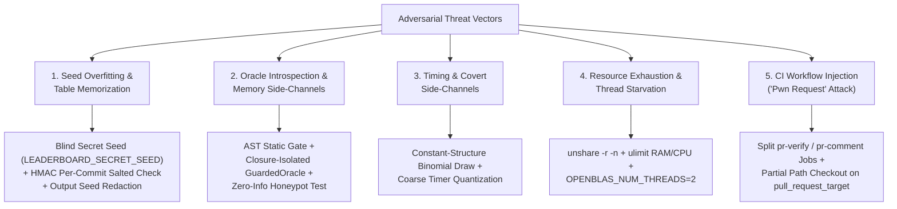

# Quantum Amplitude Estimation Challenge Leaderboard — CI/CD, PR Bot & Security Architecture Plan

## 1. Executive Summary & System Overview

The **Quantum Amplitude Estimation (AE) Challenge Leaderboard** provides an automated, reproducible, and cryptographically blind benchmarking platform for **Non-Adaptive** and **Adaptive** Quantum Amplitude Estimation algorithms in `csAE`.

Built directly atop the repository's core evaluators ([`mlqae/core.py`](../mlqae/core.py), [`leaderboard/schema_and_api.py`](schema_and_api.py), and [`leaderboard/verifier_and_runner.py`](verifier_and_runner.py)), the pipeline enforces identical physical measurement conventions, query accounting ($q(0)=1$, $q(n)=n$ for $n \ge 1$), and bootstrap confidence interval protocols across every submission.

```mermaid
flowchart LR
    subgraph Contributor["Contributor Workflow"]
        A["Fork Repo & Add<br/>leaderboard/submissions/&lt;algo_id&gt;/"] --> B["Local Smoke Check<br/>SEARCH_SEED (100,000)"]
        B --> C["Open Pull Request"]
    end

    subgraph Tier1["Tier 1: Untrusted PR Verification (pull_request)"]
        C --> D["Path Hygiene &amp;<br/>metadata.json Gate"]
        D --> E["AST Static Scanner<br/>(Forbidden Imports/Dunders)"]
        E --> F["Network-Disabled Sandbox<br/>unshare -r -n | BLAS=2<br/>N=2,000 Smoke on SEARCH_SEED"]
        F --> G["Sticky PR Bot Comment<br/>Checklist + Preliminary Metrics"]
    end

    subgraph Tier2["Tier 2: Blind Secret-Seed Certification (pull_request_target / main)"]
        G -->|Maintainer adds label<br/>'certify-leaderboard'| H["Checkout Trusted main +<br/>Extract Isolated Submission"]
        H --> I["Derive Blind Test Seed via HMAC<br/>from secrets.LEADERBOARD_SECRET_SEED<br/>&amp; unset Secret before Sandbox"]
        I --> J["Blind Holdout Benchmark (N=20,000)<br/>+ Dynamic Salted Concordance Check"]
        J --> K["Redact Numeric Seed from Outputs,<br/>Commit leaderboard.json &amp; Deploy Pages"]
    end
```



---

## 2. End-to-End Repository & Pipeline Architecture

### 2.1 Directory Hierarchy

All leaderboard infrastructure, verification tooling, certified data records, and contributor submissions are cleanly compartmentalized:

```text
csAE/
├── .github/workflows/
│   └── leaderboard_ci.yml            # Deployed copy of leaderboard/ci_workflow.yml
├── docs/
│   ├── index.html                    # Interactive ladder demo & live leaderboard UI
│   └── leaderboard_data.json         # Auto-synced certified leaderboard dataset for Pages
├── mlqae/
│   └── core.py                       # Reference schedules, exact ML, CRLB constants (KAPPA)
└── leaderboard/
    ├── ARCHITECTURE_PLAN.md          # This architecture, threat model & metric specification
    ├── SUBMISSION_GUIDE.md           # Contributor guide & minimal working examples
    ├── ci_workflow.yml               # Ready-to-deploy Two-Tier GitHub Actions workflow
    ├── schema_and_api.py             # Submission base classes, QuantumAEOracle & JSON schemas
    ├── verifier_and_runner.py        # AST scanner, GuardedOracle sandbox & benchmark runner
    ├── data/
    │   └── leaderboard.json          # Canonical append-only certified leaderboard database
    └── submissions/                  # Literature baselines & community PR submissions
        ├── mlqae_flagship_labib/
        ├── mlqae_plain_labib/
        ├── csae_esprit_labib/
        ├── chebae_rall_fuller/
        ├── iqae_grinko/
        ├── fae_nakaji/
        ├── biqae_bayesian/
        ├── mlae_pow2_suzuki/
        └── mlae_linear_suzuki/
```

### 2.2 Two-Tier CI/CD Pipeline Design ([`leaderboard/ci_workflow.yml`](ci_workflow.yml))

To balance **instant contributor feedback** (~2–3 minutes per push) with **strict protection of the secret test seed, repository secrets, and write tokens**, the CI pipeline is split into two distinct security tiers:

| Property | Tier 1: `pr-verify` + `pr-comment` | Tier 2: `certify-and-publish` |
| :--- | :--- | :--- |
| **Trigger** | `pull_request` (`opened`, `synchronize`, `reopened`) touching `submissions/**` or `leaderboard/submissions/**` | `pull_request_target` with label `certify-leaderboard`, or `push` to `main` |
| **Code Trust Boundary** | Runs untrusted PR code in `pr-verify` with `permissions: contents: read` and `persist-credentials: false` | Checks out **trusted `main`** first; extracts *only* `leaderboard/submissions/<algo_id>/` from PR SHA |
| **Secret Access** | **Zero** (`secrets.*` unavailable on fork PRs by design) | Accesses `secrets.LEADERBOARD_SECRET_SEED` (fallback `secrets.LEADERBOARD_SALT_SEED`) in parent shell prior to entering sandbox |
| **Isolation Sandbox** | `unshare --user --map-root-user --net --ipc --pid --fork`, `chmod -R a-w .`, `OPENBLAS_NUM_THREADS=2` | Same `unshare` namespace + read-only filesystem lock + secret environment scrubbing (`unset`) |
| **Resource Caps** | `4 GB` virtual RAM (`ulimit -v`), `300 s` CPU time (`ulimit -t`), `15 min` job timeout | `8 GB` virtual RAM, `1800 s` CPU time, `45 min` job timeout |
| **Trial Count & Seed** | $N = 2{,}000$ trials per scale on public `SEARCH_SEED = 100,000` | $N = 20{,}000$ trials on blind `BLIND_TEST_SEED` **plus** dynamic `SALTED_CONCORDANCE_SEED` |
| **Outputs** | Sticky PR comment with pass/fail checklist & preliminary smoke table | Redacts numeric seed, commits certified entry to `leaderboard/data/leaderboard.json`, and deploys `docs/` to GitHub Pages |

### 2.3 Submission Contract & `metadata.json` Schema

Every submission resides in its own directory `leaderboard/submissions/<algo_id>/` (where `<algo_id>` matches `^[a-z0-9_]{3,60}$`) and must contain `metadata.json` plus pure-Python source files (`<= 128 KB` total, zero binary blobs/pickles/symlinks):

```json
{
  "algo_id": "iqae_grinko",
  "algorithm_name": "Iterative Quantum Amplitude Estimation (IQAE)",
  "track": "adaptive-variable",
  "authors": ["Dmitry Grinko", "Julian Gacon", "Christa Zoufal", "Stefan Woerner"],
  "github_handle": "unitaryfoundation",
  "affiliation": "IBM Quantum / ETH Zurich",
  "paper_url": "https://www.nature.com/articles/s41534-021-00379-1",
  "pr_number": null,
  "description": "Adaptive confidence-interval halving via Clopper-Pearson binomial intervals and greedy Grover depth selection.",
  "date": "2026-10-23",
  "entrypoint": "submission.py:IQAESubmission"
}
```

---

## 3. Threat Model & Multi-Layered Security Controls

Because a competitive leaderboard executes contributor-supplied Python code against an oracle that internally holds the ground-truth amplitude $a_{\text{true}} = \sin(\theta_{\text{true}})$, our threat model addresses five adversarial vectors:



### 3.1 Threat 1: Seed Overfitting, Hyperparameter p-Hacking & Seed-Table Memorization

- **Attack Vector A (Hyperparameter p-Hacking on Public Seeds)**: At $N = 20{,}000$ trials, the Monte Carlo standard deviation of $C_{95}$ for a fixed schedule is $\approx 1.0\%\text{--}1.5\%$. If the test seed is publicly known, sweeping dozens of candidate schedules or threshold parameters on that seed produces apparent $3\%\text{--}4\%$ improvements purely by chance.
- **Attack Vector B (Direct Seed-Table Memorization)**: If an evaluation seed is hardcoded in public source files, a malicious submission could precompute the exact sequence $a_{\text{true}}^{(0)}, \dots, a_{\text{true}}^{(19999)}$ (or fingerprint the first few measurement outcomes against a lookup table) and return $a_{\text{true}}^{(k)}$ with near-zero error.
- **Mitigation — Blind Repository Secret Seed (`secrets.LEADERBOARD_SECRET_SEED`) & Salted Concordance**:
  1. **Public Development Seed (`SEARCH_SEED = 100,000`)**: Used for local algorithm development and Tier 1 PR smoke checks ($N = 2{,}000$).
  2. **Blind Official Certification Seed (`BLIND_TEST_SEED`, $N = 20{,}000$)**: Stored in GitHub Actions Encrypted Secrets as `LEADERBOARD_SECRET_SEED` (with fallback to `LEADERBOARD_SALT_SEED`). Inside Tier 2 (`certify-and-publish`), the trusted host shell derives the 64-bit / positive integer seed via HMAC-SHA256 *before* launching the sandbox:
     $$\text{SEED}_{\text{blind}} = 10^7 + \left(\operatorname{HMAC-SHA256}(\texttt{LEADERBOARD\_SECRET\_SEED},\; \texttt{"ae-leaderboard-primary-blind-test-seed-v1"})_{0..7} \bmod 9 \times 10^8\right)$$
     Because `LEADERBOARD_SECRET_SEED` never leaves the GitHub Actions secret store, **no contributor or external user knows what test amplitudes $a_{\text{true}}$ or measurement bitstreams their algorithm will be tested on**.
  3. **Dynamic Per-Submission Salted Concordance Seed (`SALTED_CONCORDANCE_SEED`)**: Simultaneously, the host shell derives a commit-specific seed:
     $$\text{SEED}_{\text{salt}} = 10^9 + \left(\operatorname{HMAC-SHA256}(\texttt{LEADERBOARD\_SECRET\_SEED},\; \texttt{algo\_id} \parallel \texttt{commit\_sha})_{0..7} \bmod 9.9 \times 10^8\right)$$
     and verifies that `C95_ave` on `SALTED_CONCORDANCE_SEED` agrees statistically with `BLIND_TEST_SEED`.
  4. **Environment Scrubbing, Log Masking & Output Redaction**:
     - Immediately after computing `BLIND_TEST_SEED` and `SALTED_CONCORDANCE_SEED`, the workflow registers `::add-mask::` for both integers and runs `unset LEADERBOARD_SECRET_SEED LEADERBOARD_SALT_SEED` *before* invoking `unshare`.
     - After `verifier_and_runner.py` finishes, Tier 2 overwrites `"seed_band": "BLIND_SECRET_SEED"` in `certified_entry.json` and replaces the numeric seed string in `certified_summary.md` so that committing `leaderboard.json` or posting the PR certification comment never reveals the derived seed integer.

#### Provisioning or Rotating `LEADERBOARD_SECRET_SEED` (Maintainer One-Liner)

Repository maintainers can provision or rotate the blind evaluation secret in 1 second using the GitHub CLI (`gh`) and `openssl`:

```bash
# Generate 256 bits of cryptographic entropy and store in GitHub Actions Secrets:
gh secret set LEADERBOARD_SECRET_SEED --body "$(openssl rand -hex 32)"

# Optional: Also set LEADERBOARD_SALT_SEED as a secondary salt backup:
gh secret set LEADERBOARD_SALT_SEED --body "$(openssl rand -hex 32)"
```

### 3.2 Threat 2: Oracle Side-Channeling & Runtime Introspection

- **Attack Vector**: In adaptive tracks, user code interacts with `oracle.measure(depth, shots)` or `oracle.measure_batch(depths, shots)` during each trial. A malicious submission might attempt to:
  - Walk the Python call stack (`sys._getframe(1).f_locals`, `inspect.currentframe()`) to read `theta_true` or `a_true` from the caller;
  - Inspect `oracle.__dict__`, `oracle.__closure__`, or `gc.get_referrers(oracle)` to extract encapsulated attributes;
  - Mutate `oracle.queries_used` to under-report query consumption;
  - Load `ctypes` / `cffi` to scan process heap memory.
- **Mitigation — Three-Layer Sandbox ([`leaderboard/verifier_and_runner.py`](verifier_and_runner.py))**:
  1. **Layer 1: Static AST Security Gate (`check_ast_security`)**:
     - Parses all `.py` files in the submission directory via Python's `ast` module prior to import.
     - **Blocked modules**: `inspect`, `ctypes`, `gc`, `subprocess`, `socket`, `ssl`, `urllib`, `http`, `requests`, `shutil`, `pty`, `fcntl`, `mmap`, `resource`, `signal`, `pickle`, `marshal`, `shelve`, `importlib`, `builtins`, `code`, `traceback`, `linecache`, `pdb`, `multiprocessing`, `threading`, `concurrent`, `asyncio`, `tempfile`, `glob`.
     - **Blocked builtins & attributes**: `globals`, `locals`, `vars`, `dir`, `eval`, `exec`, `compile`, `__import__`, `getattr`, `setattr`, `delattr`, `memoryview`, `_getframe`, `f_locals`, `f_globals`, `f_back`, `__closure__`, `cell_contents`, `__globals__`, `__code__`, `__dict__`, `__subclasses__`, `_a_true`, `a_true`, `theta_true`.
  2. **Layer 2: Lexical-Closure `GuardedOracle` with `__slots__ = ("_dispatch",)`**:
     - `a_true` and the measurement RNG are never stored as attributes on `GuardedOracle`; `__getattribute__` strictly whitelists `_ALLOWED_ORACLE_ATTRS` and `__setattr__`/`__delattr__` raise `OracleTamperError`.
  3. **Layer 3: Zero-Information Honeypot Test**:
     - Stage 4 of `verify_submission` executes the submission against a constant-$0.5$ Bernoulli coin-flip oracle (`zero_info_mode=True`) while keeping `a_true` and `theta_true` as local variables in the caller stack frame as a honeypot. Any submission whose estimates exhibit anomalous correlation ($|r| > 4.2/\sqrt{N-1}$) or low error ($\text{MAE} < 0.12$) against the honeypot `a_true` is immediately rejected.

### 3.3 Threat 3: Timing Attacks & Covert Side-Channels

- **Attack Vector**: Inferring $\theta_{\text{true}}$ from CPU timing variations in `np.random.binomial(shots, p)` or encoding secret trial amplitudes into job execution duration.
- **Mitigation**:
  - Network access is completely disabled (`unshare -r -n`), and numeric seeds are masked and redacted from all artifacts and PR comments.
  - Each trial uses an independent `PCG64DXSM` / `default_rng` stream (`alg_rng`) isolated from the oracle's private measurement stream (`meas_rng`).

### 3.4 Threat 4: Resource Exhaustion, Fork Bombs & Thread Contention

- **Attack Vector**: Allocating multi-gigabyte grids, spawning runaway BLAS thread pools that starve the runner or cause non-deterministic floating-point reductions, or writing gigabytes to disk.
- **Mitigation**:
  - Hard environment pin: `OPENBLAS_NUM_THREADS=2`, `OMP_NUM_THREADS=2`, `MKL_NUM_THREADS=2`, `NUMEXPR_NUM_THREADS=2`.
  - Linux namespace containment via `unshare --user --map-root-user --net --ipc --pid --fork`.
  - POSIX `ulimit` guards: `ulimit -v 4194304` (4 GB virtual memory in Tier 1; 8 GB in Tier 2), `ulimit -t 300` (CPU time limit), `ulimit -f 10240` (10 MB file size cap), plus read-only source tree (`chmod -R a-w .`).

### 3.5 Threat 5: GitHub Actions Workflow Injection (`Pwn Request`)

- **Attack Vector**: If a workflow triggered by `pull_request_target` checks out the PR branch and runs untrusted code or scripts, an attacker could gain access to `GITHUB_TOKEN` (`contents: write`) and `LEADERBOARD_SECRET_SEED`.
- **Mitigation**:
  - **Tier 1 (`pr-verify`)** runs on `pull_request` (unprivileged token, zero secrets, `persist-credentials: false`). It never touches `GITHUB_TOKEN` to post comments; instead, it uploads an artifact consumed by a separate downstream job **`pr-comment`**.
  - **Tier 2 (`certify-and-publish`)** runs on `pull_request_target` *only* after a maintainer manually applies the `certify-leaderboard` label after reviewing the diff. Furthermore, Tier 2 checks out `ref: main` first, verifies via `git diff` that *only* `leaderboard/submissions/<algo_id>/` changed, and runs `git checkout <PR_HEAD_SHA> -- leaderboard/submissions/<algo_id>`. Thus `leaderboard/verifier_and_runner.py`, `mlqae/core.py`, and `.github/workflows/` are guaranteed to execute from trusted `main`.

---

## 4. Metric Definitions & Challenge Tracks

### 4.1 Physical Measurement Model & Query Accounting

Across all tracks, the target parameter is the amplitude $a = \sin\theta \in (0.1, 0.9)$ drawn uniformly ($a \sim \mathcal{U}(0.1, 0.9)$, $\theta = \arcsin(a) \in (0.10017, 1.11977)$), plus a prior-robustness check on $a \sim \mathcal{U}(0.01, 0.99)$.

- **Measurement Outcome Distribution**: A single shot at Grover depth $n \in \mathbb{Z}_{\ge 0}$ under per-oracle depolarizing noise rate $\eta \ge 0$ yields outcome $1$ ($Z$-basis $+1$ outcome following [`mlqae/core.py`](../mlqae/core.py#L3-L5)) with probability:
  $$p_\eta(n, \theta) = V_n \cos^2\!\big((2n+1)\theta\big) + \frac{1 - V_n}{2}, \qquad V_n = (1 - \eta)^{2n+1}.$$
- **Oracle Query Cost Accounting** (matching [`mlqae/core.py`](../mlqae/core.py#L13-L14) and [`leaderboard/schema_and_api.py`](schema_and_api.py)):
  $$\operatorname{cost}(n) = \begin{cases} 1, & n = 0, \\ n, & n \ge 1, \end{cases} \qquad N_{\text{tot}} = \sum_{n \ge 1} n \, N_n + N_0.$$
- **Estimation Error Percentiles & Exact-Mixture CRLB Floor**:
  Over $N_{\text{trials}} = 20{,}000$ independent trials, let $e_i = |\hat{a}_i - a_i|$ be the absolute amplitude estimation error on trial $i$, and let $\varepsilon_\delta = \operatorname{Percentile}_\delta(\{e_i\}_{i=1}^{N_{\text{trials}}})$ for $\delta \in \{50, 68, 95, 99\}$.
  The exact asymptotic Cramér–Rao floor on $\varepsilon_\delta \cdot N_{\text{tot}}$ for any fixed schedule under $a \sim \mathcal{U}(0.1, 0.9)$ is governed by the quadrature constants in [`mlqae/core.py`](../mlqae/core.py#L68-L83):
  $$\kappa_{68} = 0.802408, \qquad \kappa_{95} = 1.668608, \qquad \kappa_{99} = 2.258032.$$

---

### 4.2 Competition Tracks & Ranking Metrics

| Track Identifier | Regime & Constraints | Primary Ranking Metric | Secondary Metrics |
| :--- | :--- | :--- | :--- |
| `non-adaptive` | Fixed schedule $(n_k, N_k)$ chosen prior to any measurements; 1 parallel batch round (`num_rounds = 1`) across $n_{\max} \in \{60, 125, 260, 540\}$. | Mean $C_{95,\text{ave}} = \varepsilon_{95} \cdot N_{\text{tot}}$ | $C_{99,\text{ave}}$, $C_{68,\text{ave}}$, $C_{95,\text{seq}} = \varepsilon_{95} \cdot n_{\max}$ |
| `semi-adaptive` | Small bounded number of parallel batch rounds ($R \in \{2, 3, 4\}$ via `oracle.measure_batch`). | Mean $C_{95,\text{ave}} = \varepsilon_{95} \cdot \overline{N}_{\text{tot}}$ | $C_{95,\max}$, $C_{99,\text{ave}}$, $C_{95,\text{seq}}$, rounds $R$ |
| `adaptive-fixed-budget` | Multi-round or sequential adaptive depth selection under a deterministic per-trial query budget $N_{\text{tot}} \le B$. | Mean $C_{95,\text{ave}} = \varepsilon_{95} \cdot \overline{N}_{\text{tot}}$ | $C_{95,\max}$, $C_{99,\text{ave}}$, $C_{95,\text{seq}}$ |
| `adaptive-variable` | Sequential adaptive algorithm with stopping rule (variable per-trial query count $N_{\text{tot}}^{(i)}$). | Mean $C_{95,\text{ave}} = \varepsilon_{95} \cdot \overline{N}_{\text{tot}}$ | Worst-case $C_{95,\max} = \varepsilon_{95} \cdot \max_i N_{\text{tot}}^{(i)}$, $C_{99,\text{ave}}$, $C_{95,\text{seq}}$ |
| `depth-limited` | Maximum circuit depth constrained by hardware cap $n \le M$ (`max_depth_cap = M`). | Trade-off constant $\tilde{C}_{95} = \varepsilon_{95}^2 \cdot M \cdot \overline{N}_{\text{tot}}$ | $\tilde{C}_{99}$, $\tilde{C}_{68}$ |

---

### 4.3 Published Literature Baselines Seeded in `leaderboard/submissions/`

| Submission Slug | Algorithm | Reference | Track |
| :--- | :--- | :--- | :--- |
| `mlqae_flagship_labib` | Dense-Ladder MLQAE Flagship ($r=1.45$ + cap rung at $n_{\max}/1.3$) | [arXiv:2609.02715](https://arxiv.org/abs/2609.02715) | `non-adaptive` |
| `mlqae_plain_labib` | Plain Geometric-Ladder MLQAE ($r=1.45$) | [arXiv:2609.02715](https://arxiv.org/abs/2609.02715) | `non-adaptive` |
| `csae_esprit_labib` | Compressed Sensing AE (csAE + ESPRIT) | [arXiv:2405.14697](https://arxiv.org/abs/2405.14697) | `non-adaptive` |
| `mlae_pow2_suzuki` | Exponential-Schedule Maximum-Likelihood AE (MLAE Pow2) | [Suzuki et al. (2020)](https://doi.org/10.1007/s11128-019-2565-2) | `non-adaptive` |
| `mlae_linear_suzuki` | Linear-Schedule Maximum-Likelihood AE (MLAE Linear) | [Suzuki et al. (2020)](https://doi.org/10.1007/s11128-019-2565-2) | `non-adaptive` |
| `chebae_rall_fuller` | Chebyshev Amplitude Estimation (chebAE) | [Rall & Fuller (2023)](https://quantum-journal.org/papers/q-2023-03-02-937/) | `adaptive-variable` |
| `iqae_grinko` | Iterative Quantum Amplitude Estimation (IQAE) | [Grinko et al. (2021)](https://www.nature.com/articles/s41534-021-00379-1) | `adaptive-variable` |
| `fae_nakaji` | Faster Amplitude Estimation (FAE) | [Nakaji (2020)](https://arxiv.org/abs/2003.02417) | `adaptive-variable` |
| `biqae_bayesian` | Bayesian Quantum Amplitude Estimation (BAE / BIQAE) | [Wie (2019)](https://arxiv.org/abs/1907.09965) | `adaptive-fixed-budget` |

---

## 5. Rollout Roadmap

| Phase | Milestone | Key Deliverables | Acceptance Criteria |
| :--- | :--- | :--- | :--- |
| **Phase 0: Core Harness & Literature Baselines** | Lock schema, AST verifier, and published baseline submissions | `leaderboard/verifier_and_runner.py`, `leaderboard/data/leaderboard.json`, 9 published baselines in `leaderboard/submissions/` | All published baselines (`mlqae`, `csAE`, `chebAE`, `IQAE`, `FAE`, `BIQAE`, `MLAE`) pass verification and reproduce published constants. |
| **Phase 1: Secret Seed Provisioning & Red-Team** | Configure `LEADERBOARD_SECRET_SEED` & stress-test anti-cheat sandbox | Provision `LEADERBOARD_SECRET_SEED` via `gh secret set`; run adversarial test suite (`leaderboard/test_verifier.py`) | $100\%$ of adversarial test cases blocked by AST gate, `GuardedOracle`, or Zero-Info Honeypot test. |
| **Phase 2: CI/CD Activation & Live Dashboard** | Deploy `.github/workflows/leaderboard_ci.yml` & interactive leaderboard UI in `docs/` | Active GitHub Actions pipeline + live GitHub Pages leaderboard table | Opening a PR touching `leaderboard/submissions/<algo_id>/` posts a complete Tier 1 checklist comment in $< 3\text{ minutes}$; adding `certify-leaderboard` label runs blind certification and updates GitHub Pages. |
| **Phase 3: Public Community Challenge** | Open external submissions & extended noise tracks | Add endpoint challenge track ($a \in (0.01, 0.99)$) and depolarizing noise track | Deterministic single-label maintainer certification with zero exposure of the blind test seed. |
